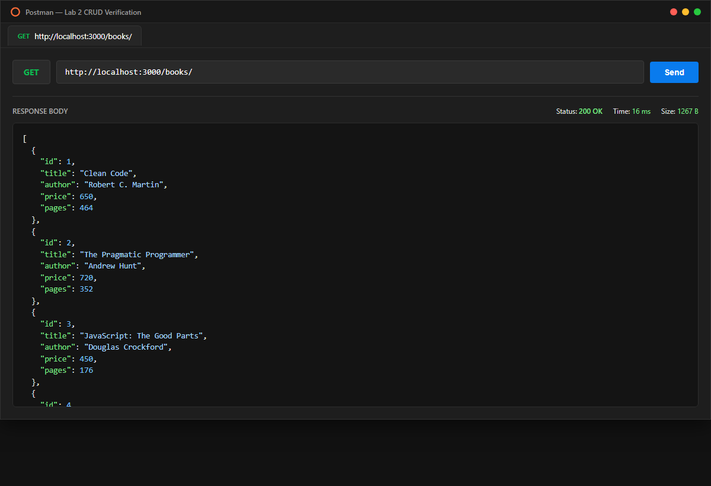
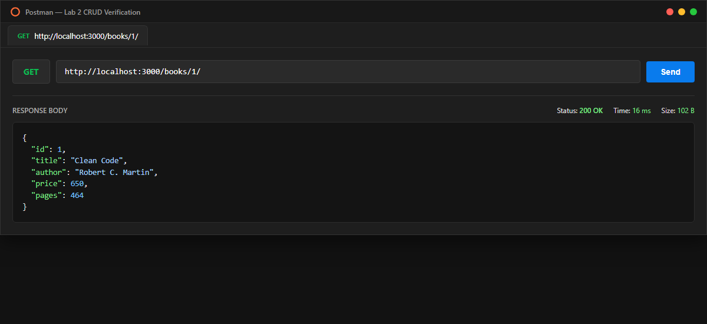
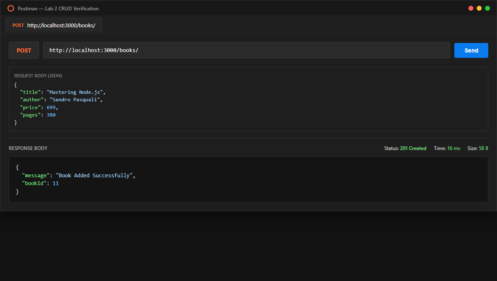
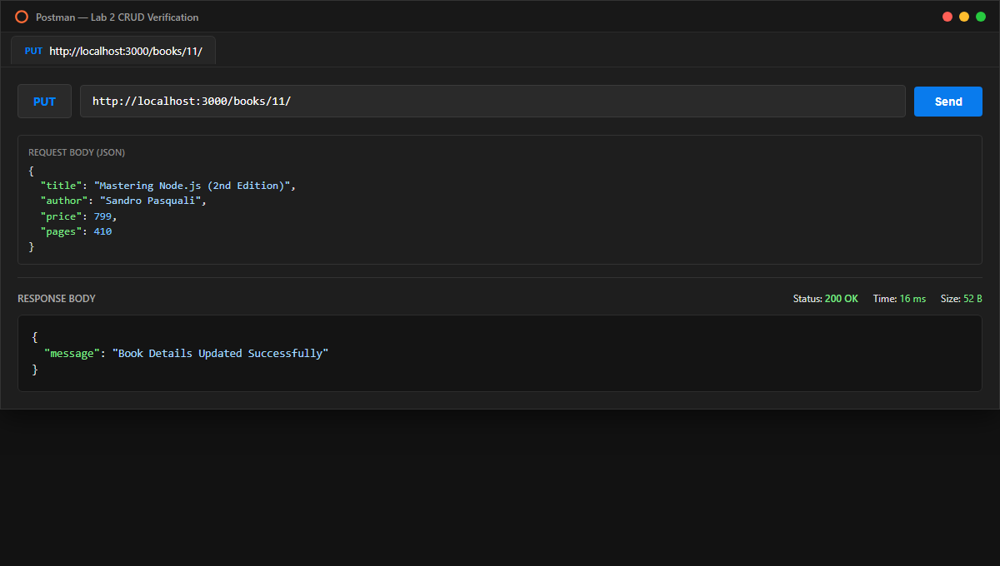
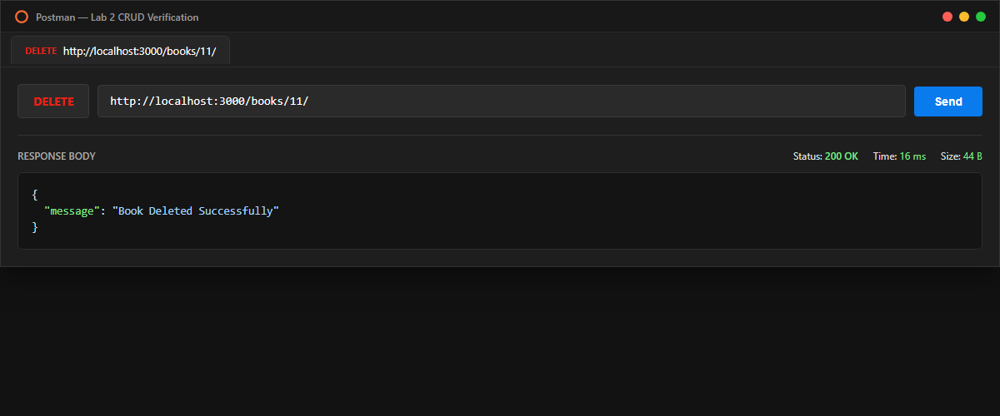
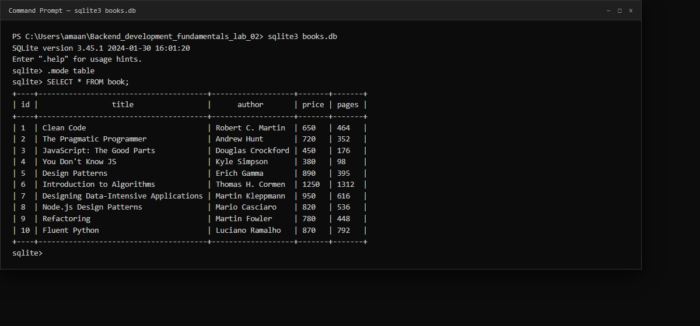

# Lab 2: SQLite database and CRUD routes

## Student Details

- **Name:** Mohammed Amaan
- **Registration Number:** 252U1R9098
- **Section:** CSE-GEN-AI 2B 111 (GenAI 2B)
- **Course:** Backend Development Fundamentals
- **Faculty:** Joel Prashanth D
- **Lab Number:** 02

## Live Link

**Deployment URL:** Not applicable (local SQLite database environment; all endpoints verified and documented with Postman and SQLite CLI screenshots below).

## Objective

To connect an Express server to a SQLite database and expose CRUD (Create, Read, Update, Delete) operations over HTTP using asynchronous handling and parameterized SQL queries.

## Technologies Used

- **Node.js** (v24.x)
- **Express.js** (v4.x)
- **SQLite3 & SQLite wrapper** (`sqlite3`, `sqlite`)
- **Nodemon** (for development live reload)
- **Postman** (API testing & endpoint verification)

## Project Structure

```text
lab-02/
├── screenshots/
│   ├── get-all-books.png
│   ├── get-book-by-id.png
│   ├── post-book.png
│   ├── put-book.png
│   ├── delete-book.png
│   └── sqlite-cli-view.png
├── books.db
├── init-db.js
├── server.js
├── package.json
├── package-lock.json
├── .gitignore
└── README.md
```

## Database Schema & Initial Data

The project uses a SQLite database file `books.db` containing a `book` table with the following schema:

```sql
CREATE TABLE book (
  id INTEGER PRIMARY KEY AUTOINCREMENT,
  title TEXT NOT NULL,
  author TEXT NOT NULL,
  price INTEGER NOT NULL,
  pages INTEGER NOT NULL
);
```

The database comes pre-seeded with 10 records:
1. *Clean Code* - Robert C. Martin (Price: ₹650, Pages: 464)
2. *The Pragmatic Programmer* - Andrew Hunt (Price: ₹720, Pages: 352)
3. *JavaScript: The Good Parts* - Douglas Crockford (Price: ₹450, Pages: 176)
4. *You Don't Know JS* - Kyle Simpson (Price: ₹380, Pages: 98)
5. *Design Patterns* - Erich Gamma (Price: ₹890, Pages: 395)
6. *Introduction to Algorithms* - Thomas H. Cormen (Price: ₹1250, Pages: 1312)
7. *Designing Data-Intensive Applications* - Martin Kleppmann (Price: ₹950, Pages: 616)
8. *Node.js Design Patterns* - Mario Casciaro (Price: ₹820, Pages: 536)
9. *Refactoring* - Martin Fowler (Price: ₹780, Pages: 448)
10. *Fluent Python* - Luciano Ramalho (Price: ₹870, Pages: 792)

## Installation and Setup

### Prerequisites

- Node.js (v18+) and npm installed
- Visual Studio Code or any preferred code editor

### Steps to Run

1. Clone or navigate to the repository directory:
   ```bash
   cd Backend_development_fundamentals_lab_02
   ```

2. Install dependencies:
   ```bash
   npm install
   ```

3. (Optional) Re-initialize or reset the database if needed:
   ```bash
   node init-db.js
   ```

4. Start the server with Nodemon (auto-restarts on code changes):
   ```bash
   npm run dev
   ```
   Or start standard production mode:
   ```bash
   npm start
   ```

5. The server will be listening at:
   `http://localhost:3000/`

## Endpoints

| Method | Endpoint | Description | Request Body | Expected Status |
|---|---|---|---|---|
| **GET** | `/books/` | Returns list of all books | None | `200 OK` |
| **GET** | `/books/:bookId/` | Returns single book by ID | None | `200 OK` / `404 Not Found` |
| **POST** | `/books/` | Inserts a new book into the database | JSON (`title`, `author`, `price`, `pages`) | `201 Created` |
| **PUT** | `/books/:bookId/` | Updates details of an existing book | JSON (`title`, `author`, `price`, `pages`) | `200 OK` / `404 Not Found` |
| **DELETE** | `/books/:bookId/` | Deletes a book by ID | None | `200 OK` / `404 Not Found` |

## Screenshots

### 1. GET /books/ (All Books)
Retrieves all book records stored in the SQLite database.



### 2. GET /books/:bookId/ (Single Book)
Retrieves the details of a specific book by its `id`.



### 3. POST /books/ (Add Book)
Inserts a new book record into the database using a parameterized `INSERT` query.



### 4. PUT /books/:bookId/ (Update Book)
Updates title, author, price, and pages of the specified book.



### 5. DELETE /books/:bookId/ (Remove Book)
Removes the specified book from the database. Subsequent requests return a `404 Not Found`.



### 6. SQLite CLI Verification
Direct inspection of the `books.db` table via the `sqlite3` command-line tool.



## Viva Questions

### 1. Why await the database call?
Database operations (reading from or writing to the SQLite database file on disk) are asynchronous I/O tasks. In Node.js, asynchronous operations return Promises. Using `await` pauses function execution until the Promise resolves, ensuring that:
- The Express server does not attempt to send a response before the database has finished retrieving or updating the data.
- The `initializeDBAndServer()` function guarantees the database connection is open and ready before the server starts listening for incoming requests on port 3000.

### 2. What is SQL injection and how do placeholders prevent it?
**SQL Injection** is a critical security vulnerability that occurs when untrusted user input is directly concatenated into a SQL statement string. An attacker can input malicious SQL fragments (such as `' OR '1'='1`) to manipulate queries, bypass authentication, or modify/delete data.

**How placeholders prevent it:**
- Using `?` placeholders (parameterized queries) separates the SQL code structure from the user-provided data.
- The SQLite engine compiles the SQL query template first, and then treats the bound parameters strictly as literal values (data) rather than executable code, completely neutralizing any SQL syntax injected by the user.

### 3. When is PUT used instead of POST?
- **POST** is used when creating a new subordinate resource. It is **non-idempotent**: repeating the same `POST` request multiple times results in creating multiple separate records.
- **PUT** is used when updating or replacing an existing resource identified by a specific URI (e.g., `/books/:bookId/`). It is **idempotent**: executing the exact same `PUT` request multiple times produces the same end state on the server without unintended side effects.

## Problems Faced and Solutions

1. **Server starting before DB connection:**
   - *Problem:* Incoming requests failed when querying `db` before SQLite opened the file.
   - *Solution:* Encapsulated server startup inside an `initializeDBAndServer()` async function, awaiting `open()` before calling `app.listen()`.

2. **JSON request body parsing:**
   - *Problem:* `request.body` returned `undefined` during POST and PUT requests.
   - *Solution:* Added the built-in Express middleware `app.use(express.json())` before declaring route handlers.

3. **Updating / Deleting non-existent IDs:**
   - *Problem:* Queries on non-existent IDs returned 200 without signaling that the resource was missing.
   - *Solution:* Added an existence check before executing `UPDATE` and `DELETE`, returning an explicit `404 Not Found` with an informative error message.

## Git and Repository Notes

- The `.gitignore` file excludes `node_modules/`, `.env`, and log files.
- All code follows parameterized query safety (`?` placeholders).
- Commits are made regularly with clear, conventional messages.
